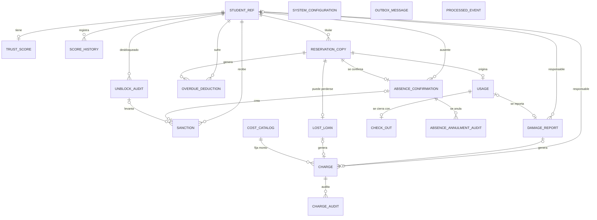
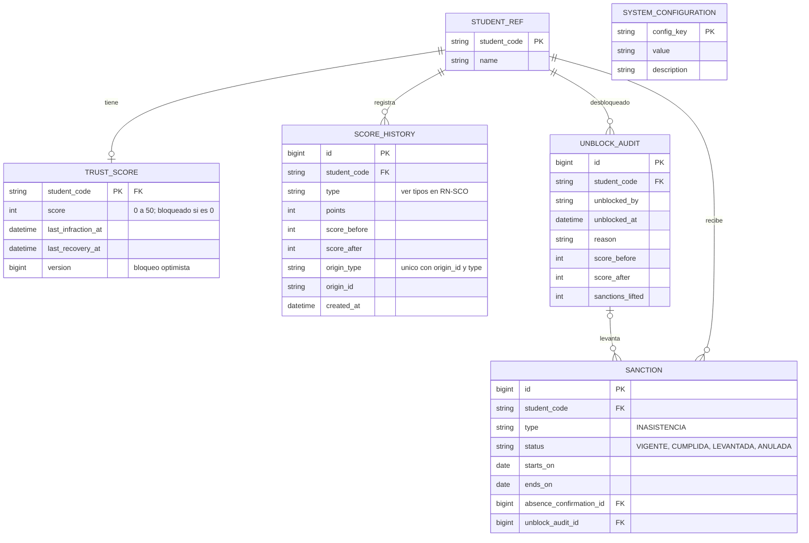
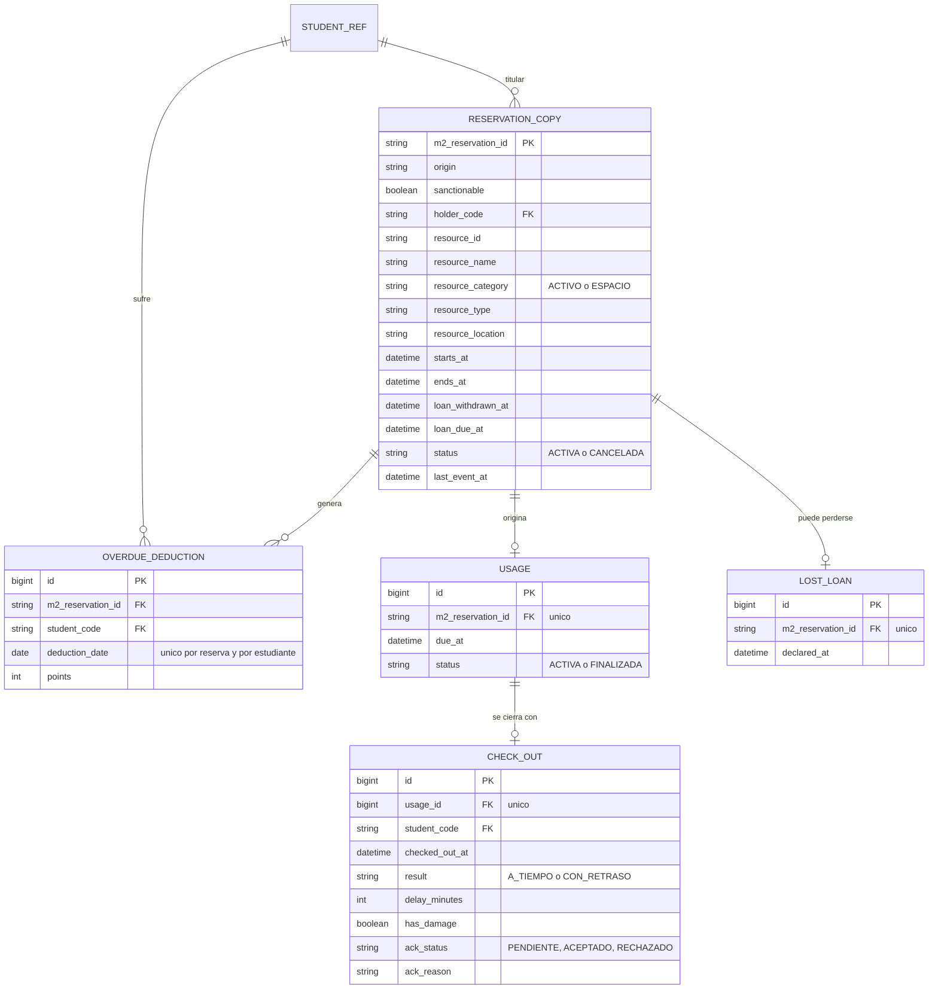
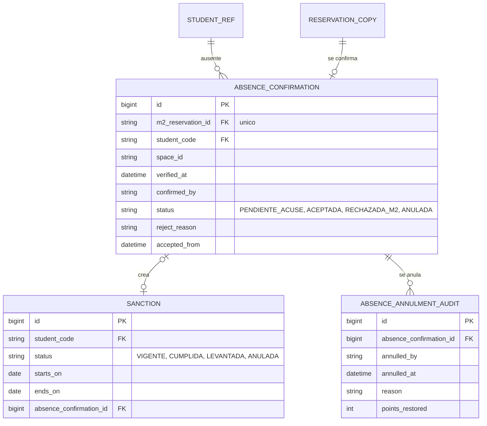
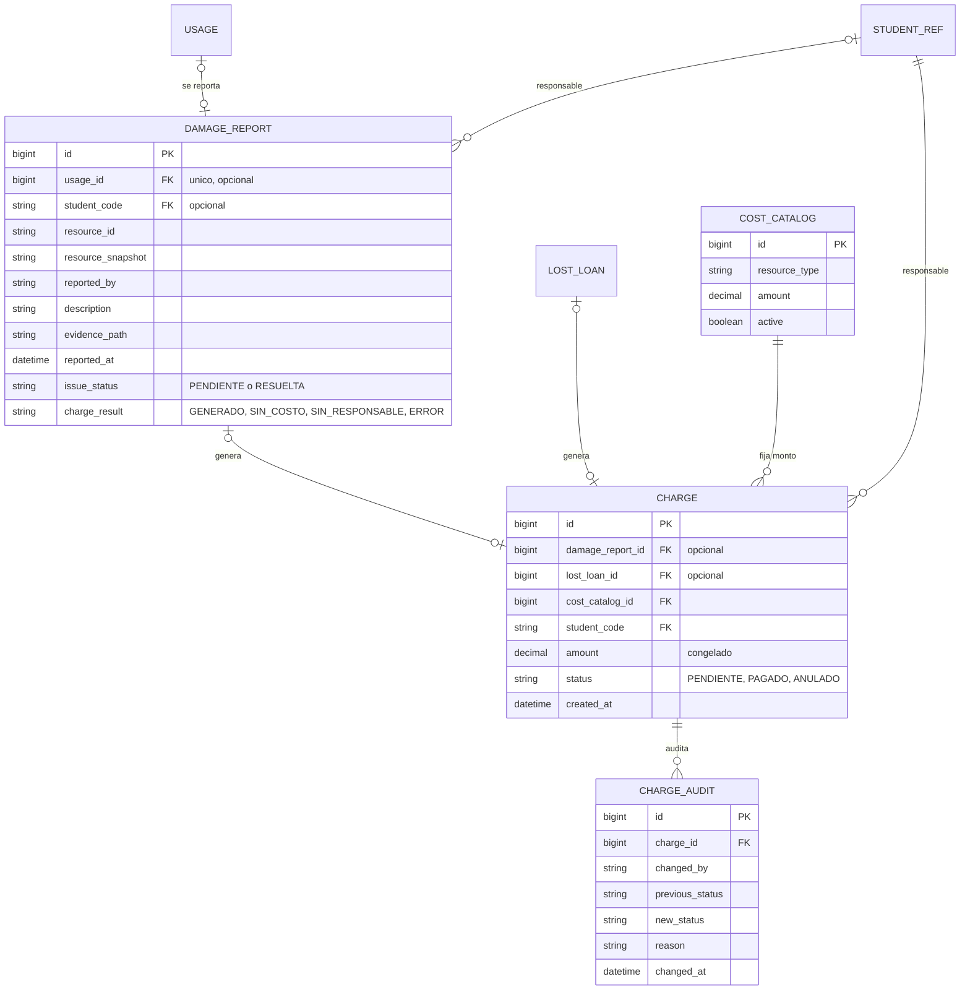
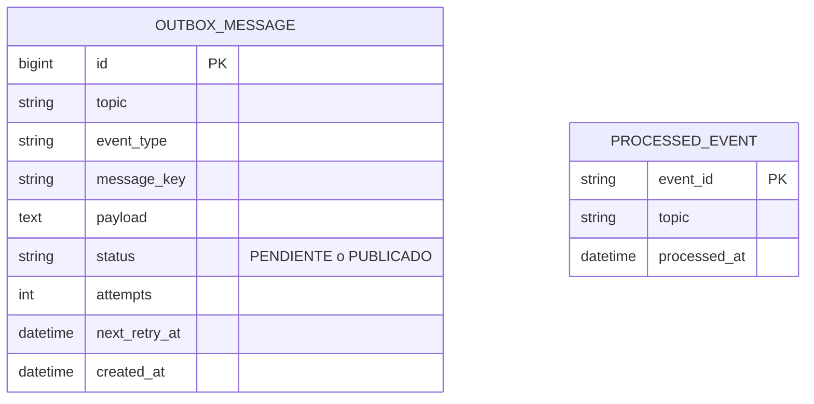

# Modelo de base de datos — Módulo 3 (Control de Uso, Sanciones y Analítica)

El modelo se divide en una **vista general** (solo tablas y relaciones) y **cinco vistas por área** con las columnas, para que cada diagrama se lea completo en GitHub. Las notas entre comillas de cada columna indican valores permitidos, unicidad u opcionalidad.

## 1. Vista general

## 2. Estudiante, score y desbloqueo

Tipos de `score_history.type`: `AUMENTO_CHECKOUT`, `REDUCCION_SANCION`, `REDUCCION_RETRASO`, `RECUPERACION`, `DESBLOQUEO_MANUAL`, `RESTITUCION_ANULACION`.

## 3. Reservas, check-out y descuento por retraso

## 4. Inasistencia

## 5. Novedad técnica y cobros

## 6. Mensajería con Kafka (outbox e inbox)

Estas dos tablas no se relacionan con las demás: `outbox_message` guarda los eventos hacia M1 y M2 hasta publicarlos, y `processed_event` evita procesar dos veces un evento recibido.
